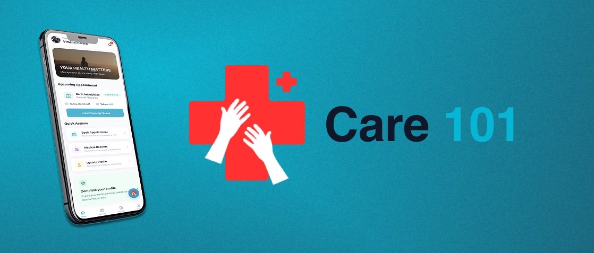

<div align="center">

[](./LICENSE)
[](https://nodejs.org/)
[](https://nextjs.org/)
[](https://expo.dev/)
[](https://github.com/damiduuofc/Care101/releases)

</div>

# Care101

<div align="center">
  
</div>

Care101 is a healthcare platform that connects patients, doctors, and hospital staff in one system. It covers appointment booking and queues, doctor workflows, AI-assisted patient summaries, lab and surgery tracking, billing, and day-to-day hospital operations.

## Overview

| Part | Folder | What it is |
| --- | --- | --- |
| Web portal | `frontend/` | Next.js app for hospital staff (admin, receptionist, nurse, lab assistant) and patient pages |
| Mobile app | `care101_app/` | Expo / React Native app (**carelink 101**) for doctors and patients |
| API server | `backend/` | Express + MongoDB API with JWT auth, Socket.IO real-time updates, Stripe, SMS, email, and AI services |

## Core Features

- **Appointments & queues** – channeling bookings, live queue numbers, today's patient list, unpaid-hold and change-cutoff rules
- **Doctor scheduling** – schedule requests, auto allocation, hour timeline with availability checks, room allocation
- **Medical records** – consultation history, medical records, surgery records, and doctor instructions shared with patients
- **Lab management** – lab test catalogue and lab requests handled from the lab assistant dashboard
- **AI assistance** – AI-generated patient summaries, predictions, and a chatbot
- **Billing & finance** – bills, channeling fees, doctor earnings, and Stripe payments
- **Notifications** – in-app real-time notifications (Socket.IO), SMS via Android SMS Gateway, and email
- **Role-based access** – `system_admin`, `receptionist`, `nurse`, `lab_assistant`, plus doctor and patient accounts

## Project Structure

```text
Care101/
├── backend/          Express API
│   ├── config/       Database config
│   ├── controllers/  Route handlers
│   ├── middleware/   Auth and role guards
│   ├── models/       Mongoose models (Appointment, Bill, Doctor, Patient, LabRequest, ...)
│   ├── routes/       REST endpoints
│   ├── services/     AI patient summary and prediction services
│   ├── utils/        Helpers (SMS, email, etc.)
│   └── uploads/      Locally stored generated files
├── frontend/         Next.js web portal
│   └── src/app/
│       ├── admin/    Staff dashboards (admin, receptionist, lab assistant, queue, billing, ...)
│       └── patient/  Patient pages
├── care101_app/      Expo mobile app
│   └── app/
│       ├── dashboard/          Doctor screens
│       └── patient-dashboard/  Patient screens
└── .github/workflows/build-apk.yml   Android APK CI build
```

## Tech Stack

### Web Frontend
- Next.js 15, React, TypeScript
- Tailwind CSS, Radix UI, Framer Motion, Lucide React
- React Hook Form + Zod
- Recharts, jsPDF
- Stripe.js, Socket.IO client
- Genkit (Google GenAI)

### Backend
- Node.js, Express
- MongoDB with Mongoose
- JWT authentication, bcrypt password hashing
- Socket.IO for real-time updates
- Stripe payments
- AI: NVIDIA API, OpenRouter, Google Generative AI
- Nodemailer (email), Android SMS Gateway (SMS)
- Multer uploads, PDFKit

### Mobile App
- Expo 55, React Native, TypeScript
- Expo Router, NativeWind
- AsyncStorage / Secure Store
- Stripe React Native SDK, Socket.IO client
- Reanimated, Moti, Expo Video

---

## Prerequisites

- Node.js v18 or later
- npm
- A MongoDB instance (local or Atlas)
- Expo Go on a phone, or an Android/iOS emulator, for the mobile app
- Optional: Stripe account, NVIDIA API key, SMTP credentials (e.g. Mailtrap), and an Android SMS Gateway device

Each app ships a `.env.example`. Copy it to `.env` and fill in the values. Never commit `.env` files.

---

## 1. Backend Setup

```bash
cd backend
npm install
cp .env.example .env
```

Fill in `backend/.env`:

| Variable | Required | Description |
| --- | --- | --- |
| `PORT` | | API port (default `5000`) |
| `MONGO_URI` | ✅ | MongoDB connection string |
| `JWT_SECRET` | ✅ | Secret for signing JWTs |
| `CLIENT_URL` | | Web portal URL (used in links and CORS) |
| `STRIPE_SECRET_KEY` | | Stripe secret key for payments |
| `NVIDIA_API_KEY` | | Key for AI features |
| `EMAIL_HOST`, `EMAIL_PORT`, `EMAIL_USER`, `EMAIL_PASS` | | SMTP settings for email (e.g. Mailtrap) |
| `SMS_GATEWAY_LOGIN`, `SMS_GATEWAY_PASSWORD`, `SMS_GATEWAY_BASE_URL`, `SMS_GATEWAY_SIM_NUMBER` | | Android SMS Gateway settings |

Optional booking settings (defaults shown):

```env
HOSPITAL_TZ=Asia/Colombo
HOSPITAL_CHANNELING_FEE=1500
DEFAULT_DOCTOR_FEE=2000
UNPAID_HOLD_MINUTES=120
MIN_UNPAID_HOLD_MINUTES=30
PATIENT_CHANGE_CUTOFF_MINUTES=60
```

Start the server:

```bash
npm run dev
```

The API runs at `http://localhost:5000` (listening on `0.0.0.0`, so devices on your network can reach it).

---

## 2. Web Portal Setup

```bash
cd frontend
npm install
cp .env.example .env
```

Fill in `frontend/.env`:

```env
NEXT_PUBLIC_API_URL=http://localhost:5000/api
NEXT_PUBLIC_STRIPE_PUBLISHABLE_KEY=your_stripe_publishable_key
```

Start the app:

```bash
npm run dev
```

The portal runs at `http://localhost:9002`. Staff sign in at `/admin/login`.

Other scripts: `npm run build`, `npm run start`, `npm run lint`, `npm run typecheck`.

---

## 3. Mobile App Setup

```bash
cd care101_app
npm install
cp .env.example .env
```

Fill in `care101_app/.env`. Use your computer's local IP (not `localhost`) so the phone can reach the API:

```env
EXPO_PUBLIC_API_URL=http://your_local_ip:5000/api
EXPO_PUBLIC_STRIPE_PUBLISHABLE_KEY=your_stripe_publishable_key
```

Find your local IP on macOS:

```bash
ipconfig getifaddr en0
```

On Windows, run `ipconfig` and use the IPv4 address.

Start the app:

```bash
npx expo start
```

Scan the QR code with Expo Go, or press `a` / `i` to open an emulator. Native builds: `npm run android` / `npm run ios`.

---

## Local Development Flow

1. Start MongoDB (or make sure your Atlas cluster is reachable)
2. Start the backend – `cd backend && npm run dev`
3. Start the web portal – `cd frontend && npm run dev`
4. Start the mobile app – `cd care101_app && npx expo start`
5. Sign in with existing users or create test accounts

---

## Android Builds (CI)

The [Build Android APK](.github/workflows/build-apk.yml) workflow builds the mobile app APK:

- Runs automatically on pushes to `main` that touch `care101_app/`, and on `v*` tags
- Can be run manually from the Actions tab (release or debug build, optional API URL override, optional GitHub Release)
- Needs these repository secrets: `EXPO_PUBLIC_API_URL`, `EXPO_PUBLIC_OPENROUTER_API_KEY`, `EXPO_PUBLIC_STRIPE_PUBLISHABLE_KEY`

To publish a release, tag a version (e.g. `v2.2.4`) and push the tag; the APK is attached to the GitHub Release.

---

## Contributing

Contributions are welcome. Please read [CONTRIBUTING.md](./CONTRIBUTING.md) and the [Code of Conduct](./CODE_OF_CONDUCT.md) before opening a pull request. To report a security issue, see [SECURITY.md](./SECURITY.md).

## License

This project is licensed under the [MIT License](./LICENSE).

## Author

- [Damiduuofc](https://github.com/damiduuofc)
